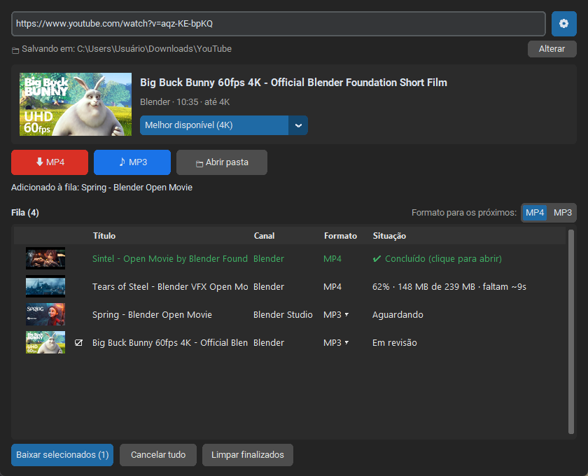

# ColouBaixô

**Colou o link, baixou o vídeo.**

Programa gratuito para Windows que baixa vídeos do YouTube em **MP4** (até 4K) ou só o áudio em **MP3**, com a pasta organizada por canal.

### [⬇ Baixar o instalador](https://github.com/clauberteixeira/ColouBaixou/releases/latest)

Windows 10 ou 11 · 64 bits · grátis · sem propaganda

---

## O que ele faz

- 🎬 **Vídeo em MP4** na melhor qualidade que o vídeo tiver (até 4K), que abre em qualquer TV, celular ou computador.
- 🎵 **Só o áudio em MP3** (320 kbps), com a capa do vídeo e o nome do canal.
- 📋 **Vários vídeos de uma vez:** cole vários links e escolha quais baixar.
- 📃 **Playlists e Mix do YouTube:** escolha os vídeos de uma lista.
- 📁 **Tudo organizado:** `Vídeos\<Canal>` e `Áudios\<Canal>`, na pasta que você escolher.
- 💻 **Funciona em qualquer computador:** o programa se adapta à máquina. Em computadores mais simples, ele evita as conversões demoradas.

## Como começar

1. **[Baixe o instalador](https://github.com/clauberteixeira/ColouBaixou/releases/latest)** (arquivo `ColouBaixou-Setup-….exe`, cerca de 64 MB).
2. Abra o arquivo e siga o **[passo a passo de instalação](docs/INSTALACAO.md)**.
   > O Windows pode mostrar "O Windows protegeu o computador". É normal para programas gratuitos sem assinatura paga. [Veja como continuar](docs/INSTALACAO.md#o-windows-protegeu-o-computador).
3. Abra o **ColouBaixô**, cole o link do YouTube e clique em **MP4** ou **MP3**.

## Guias

| | |
|---|---|
| 📥 [**Como instalar**](docs/INSTALACAO.md) | Passo a passo, incluindo o aviso do Windows |
| ▶️ [**Como usar**](docs/COMO-USAR.md) | Um vídeo, vários vídeos, playlists, MP3, qualidade e pasta |
| ❓ [**Perguntas frequentes**](docs/PERGUNTAS-FREQUENTES.md) | "Onde ficou o arquivo?", "Deu bloqueio", "Demorou", desinstalar… |
| 🐞 [**Encontrou um problema?**](https://github.com/clauberteixeira/ColouBaixou/issues/new/choose) | Conte o que aconteceu e a gente tenta resolver |
| 🛠️ [Para desenvolvedores](docs/DESENVOLVIMENTO.md) | Como gerar o programa e o instalador |

## Use com responsabilidade

O ColouBaixô é um projeto pessoal, gratuito e sem fins comerciais, feito para ajudar família e amigos. Baixe **apenas** vídeos seus, conteúdos com licença livre (Creative Commons) ou com permissão do autor. Os termos do YouTube não permitem baixar outros conteúdos sem autorização. Cada pessoa é responsável pelo que baixa.

O ColouBaixô não tem nenhuma ligação com o YouTube ou com o Google.

---

Feito com [yt-dlp](https://github.com/yt-dlp/yt-dlp), [FFmpeg](https://ffmpeg.org) e [CustomTkinter](https://github.com/TomSchimansky/CustomTkinter). Licença [MIT](LICENSE). As imagens dos guias usam filmes abertos da [Blender Foundation](https://studio.blender.org/films/) (CC BY).
