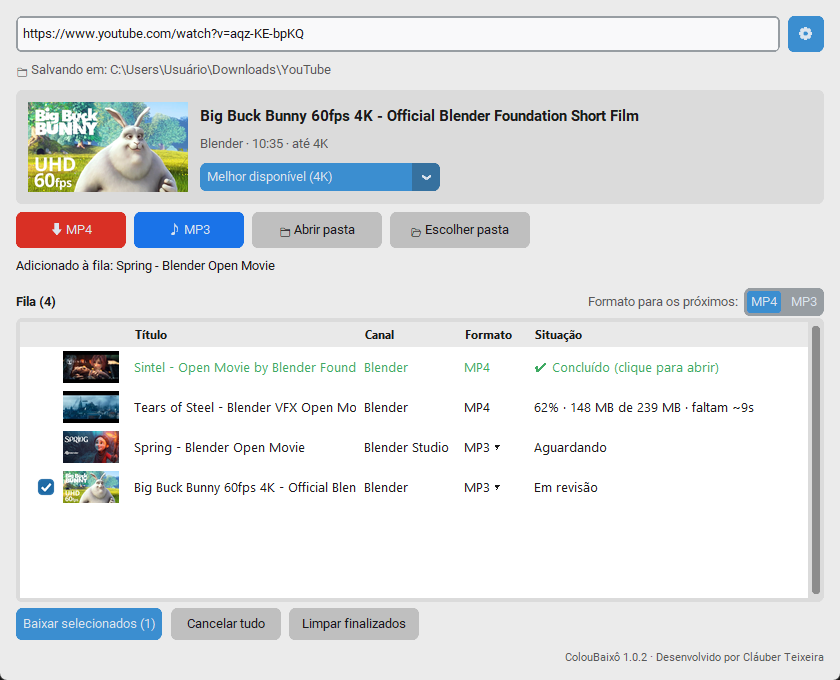
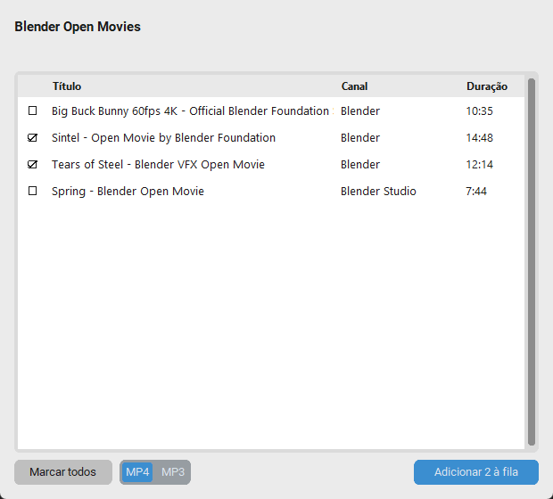
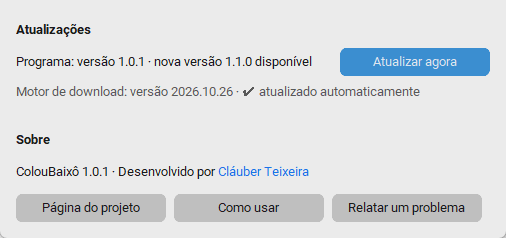
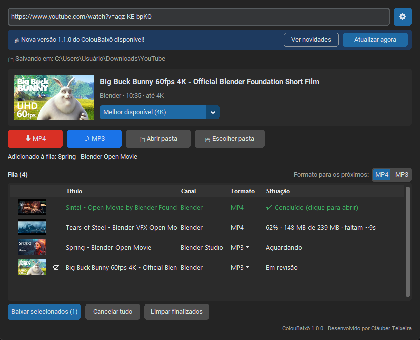

# Como usar o ColouBaixô

[← Voltar](../README.md)

- [Baixar um vídeo](#baixar-um-vídeo)
- [Baixar só o áudio (MP3)](#baixar-só-o-áudio-mp3)
- [Escolher a qualidade](#escolher-a-qualidade)
- [Baixar vários vídeos de uma vez](#baixar-vários-vídeos-de-uma-vez)
- [Baixar de uma playlist ou Mix](#baixar-de-uma-playlist-ou-mix)
- [A fila de downloads](#a-fila-de-downloads)
- [Onde os arquivos ficam](#onde-os-arquivos-ficam)
- [Atualizações](#atualizações)



---

## Baixar um vídeo

1. No YouTube, copie o link do vídeo (barra de endereço, ou **Compartilhar → Copiar**).
2. Abra o ColouBaixô. **Se o link já estiver copiado, ele aparece colado sozinho.** Se não estiver, clique no campo de cima e cole com `Ctrl + V`.
3. Aparece a **prévia**, com a capa, o título, o canal e a duração.
4. Clique em **⬇ MP4**.

O vídeo entra na **fila** (parte de baixo da tela) e começa a baixar. Você acompanha a porcentagem e o tempo que falta. Quando terminar, aparece **✔ Concluído**. Clique nesse texto para abrir a pasta com o arquivo já selecionado.

## Baixar só o áudio (MP3)

Faça igual ao vídeo, mas clique em **♪ MP3**. O arquivo sai em MP3 de alta qualidade (320 kbps), com a capa do vídeo e o nome do canal como artista.

## Escolher a qualidade

Na prévia, o seletor começa em **Melhor disponível**, que é a melhor qualidade para o **seu** computador:

- **Computador com placa de vídeo NVIDIA:** até **4K**, quando o vídeo tiver.
- **Outros computadores:** a melhor qualidade que **não precisa de conversão** (normalmente 1080p, que já fica ótima na TV), porque é rápida em qualquer máquina. As qualidades maiores continuam na lista com o aviso **"(pode demorar neste PC)"**.

Para ocupar menos espaço, escolha uma qualidade menor (720p, 480p…).

## Baixar vários vídeos de uma vez

1. Copie vários links, um por linha. Pode ser direto de uma conversa do WhatsApp, porque o programa ignora o texto em volta.
2. Clique no campo de cima e cole com `Ctrl + V`.
3. Os vídeos entram na fila como **Em revisão**, todos marcados (☑).
4. **Desmarque** o que não quiser: clique na caixinha ☑ e ela vira ☐.
5. Para trocar entre vídeo e áudio, clique em **MP4 ▾ / MP3 ▾** na linha do vídeo.
6. Clique em **Baixar selecionados**.

> **Formato para os próximos** (acima da fila, à direita) define se os próximos links colados entram como MP4 ou MP3.

Links colados **nunca começam a baixar sozinhos**: você sempre confere antes.

## Baixar de uma playlist ou Mix

Quando o link faz parte de uma playlist (por exemplo, um **Mix do YouTube**), o programa pergunta:

- **Só este vídeo:** baixa só o vídeo do link.
- **Ver a playlist:** abre a lista de vídeos.



Na lista:

1. O vídeo do link já vem marcado. Clique nas linhas para marcar ou desmarcar, ou use **Marcar todos**.
2. Escolha **MP4** ou **MP3** embaixo.
3. Clique em **Adicionar … à fila**.

> Os **Mix do YouTube** são listas que nunca terminam, então o programa mostra só os **primeiros 50 vídeos**. Playlists comuns mostram até 500.

## A fila de downloads

Os vídeos baixam **um de cada vez**, na ordem. Você pode continuar colando links enquanto a fila trabalha.

| Situação | O que significa |
|---|---|
| **Em revisão** | Colado, esperando você conferir e clicar em *Baixar selecionados* |
| **Aguardando** | Na fila, esperando a vez |
| **62% · 48 MB de 77 MB · faltam ~9s** | Baixando |
| **Convertendo…** | Ajustando o vídeo para abrir em qualquer aparelho |
| **✔ Concluído** | Pronto: clique para abrir a pasta |
| **Erro: …** | Não deu certo (o motivo aparece escrito). Os outros vídeos continuam |

- **✕** remove o vídeo da fila (se estiver baixando, cancela).
- **Cancelar tudo** cancela o que está baixando e o que está aguardando. Os itens *Em revisão* continuam.
- **Limpar finalizados** tira da lista os concluídos, os com erro e os cancelados.
- Ao fechar o programa com algo baixando, ele pergunta antes de cancelar.

## Onde os arquivos ficam

A pasta aparece no topo, em **📁 Salvando em**. O padrão é `Downloads\YouTube`. Para trocar, clique em **📂 Escolher pasta** (ao lado de *Abrir pasta*) e escolha outra. A escolha fica gravada para as próximas vezes.

Dentro dela, tudo vai organizado:

```
YouTube\
├── Vídeos\
│   └── Nome do Canal\
│       └── Título do vídeo.mp4
└── Áudios\
    └── Nome do Canal\
        └── Título do vídeo.mp3
```

Se você baixar o mesmo vídeo de novo, o arquivo novo ganha um número, como `Título (2).mp4`. Nada é apagado.

**📁 Abrir pasta** abre a pasta do último arquivo baixado.

O botão **⚙** (canto superior direito) mostra a versão do programa, as atualizações e os links de ajuda.



## Atualizações

Você não precisa fazer nada:

- **Motor de download:** se atualiza sozinho toda vez que o programa abre. É ele que acompanha as mudanças do YouTube.


- **ColouBaixô:** quando sai uma versão nova, aparece uma faixa no topo: *"🎉 Nova versão disponível!"*. Clique em **Atualizar agora**. O programa baixa a versão nova, instala e **abre de novo sozinho**. Se quiser saber o que mudou antes, clique em **Ver novidades**.

Os downloads em andamento são cancelados ao atualizar (o programa pergunta antes).
